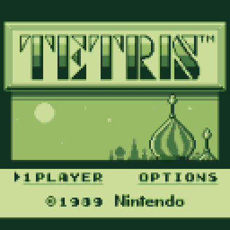

# TETRIS for CHGame

A native single-player reproduction of Game Boy Tetris for CHGame Rev0.
The 10×18 well, Nintendo rotation boxes, A/B rotation, soft drop, 23/9-frame
horizontal repeat, level speeds, line scores, next-piece toggle, A-Type
marathon and B-Type 25-line challenge follow the original handheld game.



## Download

[Release 1.1.8](https://github.com/juliendorra/tetris-chgame/releases/tag/v1.1.8)
contains the tested CHGame Rev0 builds:

| File | Use |
| --- | --- |
| [Tetris-rev0.chgame](https://github.com/juliendorra/tetris-chgame/releases/latest/download/Tetris-rev0.chgame) | Shareable cartridge with artwork, metadata and license notices |
| [Tetris-rev0.chg](https://github.com/juliendorra/tetris-chgame/releases/latest/download/Tetris-rev0.chg) | SD game-menu build with artwork and metadata |
| [Tetris-rev0.bin](https://github.com/juliendorra/tetris-chgame/releases/latest/download/Tetris-rev0.bin) | Raw firmware for USB upload |
| [Tetris-rev0.hex](https://github.com/juliendorra/tetris-chgame/releases/latest/download/Tetris-rev0.hex) | Intel HEX application image |

The release includes [SHA-256 checksums](https://github.com/juliendorra/tetris-chgame/releases/latest/download/SHA256SUMS.txt)
and [license notices](https://github.com/juliendorra/tetris-chgame/releases/latest/download/LICENSES.txt).
Prepare the save journal before installing this version. With the CHGame tools installed,
flash the cartridge using `chgame cart flash Tetris-rev0.chgame`.
For an existing SD menu, install the `.chg` through your usual menu workflow;
on a console using Dorra's category, its path is `GAMES/MYGAMESP/TETRIS.CHG`.

## The experiment

This is an experimental project about reproducing existing software on new
platforms with AI-assisted development. It explores an emerging way of working:
using AI to help write a native implementation, inspect source references and
build comparisons, then revising the result against evidence from the original
game and the target hardware.

Reproduction in software is different from emulation. An emulator runs the
original program against a model of its machine; a reproduction implements its
behavior again. Such reproductions have often accumulated issues, omissions
and approximations, even when their first screenshots looked convincing. Here,
line-clear timing, gravity, block patterns and music all needed further work
after the game was already playable. Their details affect how the game feels.

The project asks what becomes possible when AI makes this work less costly,
and whether systematic comparisons can also make porting less risky. That is
a research question, rather than a demonstrated general result: this project
has no controlled comparison of development cost or defect rates. Generating
an implementation still leaves the work of finding references, checking
behavior and deciding which differences are acceptable.

Preserving gameplay matters as older machines become rarer and harder to
maintain. Native reproductions offer another way to keep a game playable on
new hardware, alongside emulation and preservation of the original machines.
Recording the remaining differences is part of that work.

There is also a display experiment here. The Game Boy has a 160×144
four-shade monochrome image; CHGame has fewer pixels, but a color display.
The renderer uses intermediate color shades to represent partial pixel
coverage when reducing the image. The aim is to retain thin strokes, patterns
and proportions rather than simply recolor the game. The extra shades help
with the lower resolution, but cannot recover every lost detail.

## Display

The screen designs use the original DMG tile artwork and layout: the framed
logo and skyline, stippled menus, eight-pixel font, brick well borders, black
sidebar, boxed counters, individual block patterns, pause text and game-over
panel. [The comparison sheet](Tetris/docs/dmg-comparison.png) shows the reconstructed
DMG references beside the previous and revised CHGame designs.

The original 160×144 composition is reduced uniformly by 4/5 and centered in
the 128×128 framebuffer. This preserves its proportions and all 18 well rows.
The default **Color LCD** palette uses sixteen green coverage shades: an area
filter preserves fractional strokes and block edges from the four-grey source.
It processes the entire design, including text and artwork. SELECT on the
title cycles Color LCD, classic four-shade DMG, and Silver LCD. Only changed
tiles and their filter boundaries are redrawn; no full second framebuffer is
needed. Small top and bottom margins preserve the original aspect ratio.

## Play

START opens game selection. Choose A-Type or B-Type, then choose the soundtrack
and a starting level from 0–9. B-Type also offers six initial pile heights.
Hold DOWN while pressing START on the title to enable the original heart mode,
which adds ten levels to the falling speed. The original high-level speed cap
is retained. B or the title's OPTIONS selection shows the controls. OPTIONS
occupies the original two-player slot; link multiplayer is not implemented.
The level and height grids use the original row arrangements and navigation.

| Button | During play |
| --- | --- |
| Left / Right | Move; held input repeats after 23 frames, then every 9 |
| A (left face button) | Rotate left / counterclockwise |
| B (right face button) | Rotate right / clockwise |
| Down | Soft drop; release between pieces to re-arm |
| SELECT | Hide / reveal the next piece |
| START | Pause / resume; hold 3 seconds for the CHGame menu |

The pause screen hides the stack. A or START resumes, B returns to options,
and SELECT cycles the music setting. A-Type scores 40/100/300/1200 × (level+1)
for one/two/three/four lines, plus the uninterrupted soft-drop distance. Scores
cap at 999,999. A-Type advances at each next level's ten-line threshold;
B-Type keeps its selected speed and ends after 25 lines. Three named high
scores per game type, palette and soundtrack settings persist in flash.

One intentional change was necessary for rotation. CHGame places A on the
left and B on the right, opposite to the Game Boy's arrangement. The A/B
rotation assignments are therefore swapped: **A rotates left and B rotates
right**, preserving the physical left/right relationship. The
[in-game controls screen](Tetris/docs/controls.png) uses the same mapping; both
directions were checked on the console.

Completed rows follow the DMG animation: three whole-row grey/block flashes,
ten frames per half-flash, then thirteen blank frames and a bottom-to-top
redraw of the collapsed field, one row per frame. The next piece appears
with the last redraw. [The animation capture](Tetris/docs/line-clear.gif) shows it.
Timing follows `AnimateLineClear` and the row-wipe routines in the
[pinned DMG disassembly](https://github.com/kaspermeerts/tetris/blob/b95c66859339f5523e80213de5857eefc1c7703f/tetris.asm#L5412).
The gravity counter follows the DMG's zero-frame behavior: actual intervals
for levels 0–9 are **53, 49, 45, 41, 37, 33, 28, 22, 17, 11 frames per row**.
Level 9 therefore drops about 5.45 rows per second at CHGame's 60 Hz.

## Music

The original two-by-two music menu offers **A-TYPE, B-TYPE, C-TYPE and OFF**.
A-TYPE is Korobeiniki, B-TYPE is Hirokazu Tanaka's original piece, and C-TYPE
is the Game Boy arrangement of Bach's French Suite No. 3 Menuet. A-TYPE is
the default. There is no extended variant.

All three scores use the original DMG channel parts, note lengths, rests,
envelopes, pulse duties, wave patterns, pitch-register values, vibrato and
independent loop points from the pinned disassembly. Their score clock is
the original 4,194,304 / 70,224 Hz video-frame cadence. Pulse-part loops last
about 38.575 / 35.361 / 38.575 seconds for A / B / C; B's wave part retains
the original 24-frame longer loop. The native player interprets score data;
it does not execute Game Boy code.

The player outputs 31,250 PCM samples per second through PWM. Version 1.1.7
retains the source instrument data and gives both pulse parts the same static
1.5x output lift. Wave and percussion parts retain their previous balance;
percussion remains at half amplitude. A Tetris-specific, mostly linear output
stage leaves normal note decays intact, with limiting reserved for high peaks.
Playback uses the full master level. Routine movement/rotation/landing cues
no longer duck the music, and their cue levels are lower. Major events apply
only a small music reduction. See [the fidelity and output checks](Tetris/docs/audio-update.md).

OFF keeps game cues, pause freezes the score, and danger tempo runs at 125%
without restarting. `Tetris/tools/make_music.py` regenerates the original music data
and source-derived validation facts from `Tetris/references/dmg/audio/`. URLs and
source hashes are in `Tetris/tools/music.json`.
The ATM demo itself is unchanged. Older settings migrate while retaining
high scores and palette; the removed extension maps to original A-TYPE.

## Build and run

Install Git, Python 3.12 or newer, `uv`, Arduino CLI and Clang (`clang++`).
Clone with the pinned CHGame dependency:

```sh
git clone --recurse-submodules https://github.com/juliendorra/tetris-chgame.git
cd tetris-chgame
python3 tetris.py setup
python3 tetris.py test
python3 tetris.py sim
python3 tetris.py build
python3 tetris.py export --no-build
python3 tetris.py cart verify Tetris/build/Tetris.chgame
```

Setup keeps the Python environment, board package and caches inside this
checkout. On Apple silicon it builds the native RISC-V GCC 16.2 compiler
before compiling the game; see [the toolchain notes](tools/toolchain/README.md)
for prerequisites and the longer first-run setup. Other hosts use the board
package's compiler and have not been validated for this reproduction.

For host tests and simulator checks alone, the board package and RISC-V
compiler are unnecessary. After cloning, use:

```sh
uv venv --python python3 .venv
uv pip install --python .venv/bin/python --requirement requirements.txt
python3 tetris.py check --no-device
```

The firmware is `Tetris/build/release/Tetris.ino.bin`; the cartridge is
`Tetris/build/Tetris.chgame`. Neither testing, building nor packaging uploads
to the handheld. `python3 tetris.py upload` builds and flashes over USB.
The wrapper accepts `CHGAME_PYTHON` to use an existing Python environment.
The source and full validation instructions are in [Tetris/](Tetris/README.md).

## Evidence and remaining differences

The checks cover 500,000 adversarial gameplay frames under UBSan, all 93
line-clear frames across five fixtures, static screen regions reconstructed
from the original tilemaps, and three loops of each original music score.
Incremental rendering is compared with full redraws. Physical level-9 timing
was measured at about 60 fps, with the expected 11-frame row interval.
The compiled RISC-V firmware was also tested in a CHGame emulator. The
original Game Boy program was not run in a Game Boy emulator for these checks.

Those checks establish specific agreements, not complete equivalence. Link
multiplayer and exact ending animations are absent. The seeded randomizer
uses the original rejection rule but cannot reproduce the Game Boy divider's
piece sequence. Sound cues are newly authored, PWM synthesis is not a
cycle-exact Game Boy APU model, and percussion is attenuated for CHGame.
Speaker quality has not been independently assessed. The lower-resolution
screen and the rotation-button swap are intentional platform adaptations.

Version **1.1.4** was installed and started on a physical CHGame Rev0 under
Dorra's category. Its firmware is 28,444 bytes, with CRC32 `0xD7D04FA3`.
[Detailed checks and measurements](Tetris/README.md#verification-and-scope),
[display comparison](Tetris/docs/dmg-comparison.png),
[hardware timing](Tetris/docs/device-speed.json), and
[installation record](Tetris/docs/console-install.json) document the scope.

## Sources and rights

The implementation uses the published [Game Boy Tetris disassembly](https://github.com/kaspermeerts/tetris/tree/b95c66859339f5523e80213de5857eefc1c7703f)
as a reference for rules, graphical assets and the original score data.
Reference revisions, URLs and hashes are retained in the source tree.
The native PWM output and cue mixer come from the
[ATM Soundtracks project](https://github.com/juliendorra/chgame-soundtracks).
[CHGame](https://github.com/bateske/CHGame) is a pinned external dependency.

The independently written game software uses the BSD 3-Clause license.
Original artwork, music, arrangements and trademarks retain their respective
rights and are outside that software license. No Game Boy ROM or executable
binary is bundled. This is an independent experimental project, with no
claim of affiliation with Nintendo or the Tetris rights holders.
See [LICENSE](LICENSE), [NOTICE](NOTICE) and [dependency licenses](Tetris/licenses/).


## Audio update 1.1.7

The original A/B/C score and instrument definitions are retained. Both pulse parts receive a static output lift, playback uses the full master level, and a wider linear output range preserves normal note decays. Routine movement/rotation/landing cues no longer duck the soundtrack and are quieter. Major event cues use only a small music reduction.

[Audio validation notes](Tetris/docs/audio-update.md).

## SD saves

Uses [CHSave 0.3](https://github.com/juliendorra/chgame-sd-saves).
App ID: `com.juliendorra.tetris`. Firmware has no legacy save fallback.

```sh
# New card:
python3 tools/sd_saves.py prepare --card /path/to/card
# Existing four-character journal; old file is kept:
python3 tools/sd_saves.py migrate --card /path/to/card
```

Convert existing saves before installing this build. Keep the hashed `.SAV`
files when replacing cartridges. The complete ID is checked before writing.
