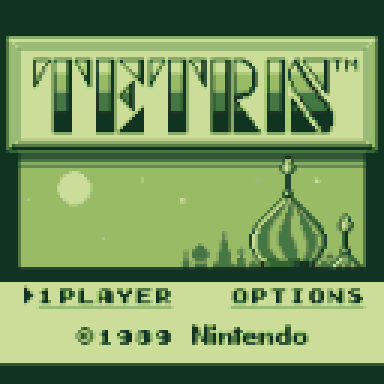

# TETRIS for CHGame

A native single-player reproduction of Game Boy Tetris for CHGame Rev0.
The 10×18 well, Nintendo rotation boxes, A/B rotation, soft drop, 23/9-frame
horizontal repeat, level speeds, line scores, next-piece toggle, A-Type
marathon and B-Type 25-line challenge follow the original handheld game.



## The experiment

This is an experimental project about reproducing existing software on new
platforms with AI-assisted development. It explores an emerging way of working:
using AI to help write a native implementation, inspect source references and
build comparisons, then revising the result against evidence from the original
game and the target hardware.

Reproduction in software is different from emulation. An emulator runs the
original program against a model of its machine; a reproduction implements its
behavior again. Such reproductions have often accumulated issues, omissions
and approximations, even when their first screenshots looked convincing. Here,
line-clear timing, gravity, block patterns and music all needed further work
after the game was already playable. Their details affect how the game feels.

The project asks what becomes possible when AI makes this work less costly,
and whether systematic comparisons can also make porting less risky. That is
a research question, rather than a demonstrated general result: this project
has no controlled comparison of development cost or defect rates. Generating
an implementation still leaves the work of finding references, checking
behavior and deciding which differences are acceptable.

Preserving gameplay matters as older machines become rarer and harder to
maintain. Native reproductions offer another way to keep a game playable on
new hardware, alongside emulation and preservation of the original machines.
Recording the remaining differences is part of that work.

There is also a display experiment here. The Game Boy has a 160×144
four-shade monochrome image; CHGame has fewer pixels, but a color display.
The renderer uses intermediate color shades to represent partial pixel
coverage when reducing the image. The aim is to retain thin strokes, patterns
and proportions rather than simply recolor the game. The extra shades help
with the lower resolution, but cannot recover every lost detail.

## Display

The screen designs use the original DMG tile artwork and layout: the framed
logo and skyline, stippled menus, eight-pixel font, brick well borders, black
sidebar, boxed counters, individual block patterns, pause text and game-over
panel. [The comparison sheet](docs/dmg-comparison.png) shows the reconstructed
DMG references beside the previous and revised CHGame designs.

The original 160×144 composition is reduced uniformly by 4/5 and centered in
the 128×128 framebuffer. This preserves its proportions and all 18 well rows.
The default **Color LCD** palette uses sixteen green coverage shades: an area
filter preserves fractional strokes and block edges from the four-grey source.
It processes the entire design, including text and artwork. SELECT on the
title cycles Color LCD, classic four-shade DMG, and Silver LCD. Only changed
tiles and their filter boundaries are redrawn; no full second framebuffer is
needed. Small top and bottom margins preserve the original aspect ratio.

## Play

START opens game selection. Choose A-Type or B-Type, then choose the soundtrack
and a starting level from 0–9. B-Type also offers six initial pile heights.
Hold DOWN while pressing START on the title to enable the original heart mode,
which adds ten levels to the falling speed. The original high-level speed cap
is retained. B or the title's OPTIONS selection shows the controls. OPTIONS
occupies the original two-player slot; link multiplayer is not implemented.
The level and height grids use the original row arrangements and navigation.

| Button | During play |
| --- | --- |
| Left / Right | Move; held input repeats after 23 frames, then every 9 |
| A (left face button) | Rotate left / counterclockwise |
| B (right face button) | Rotate right / clockwise |
| Down | Soft drop; release between pieces to re-arm |
| SELECT | Hide / reveal the next piece |
| START | Pause / resume; hold 3 seconds for the CHGame menu |

The pause screen hides the stack. A or START resumes, B returns to options,
and SELECT cycles the music setting. A-Type scores 40/100/300/1200 × (level+1)
for one/two/three/four lines, plus the uninterrupted soft-drop distance. Scores
cap at 999,999. A-Type advances at each next level's ten-line threshold;
B-Type keeps its selected speed and ends after 25 lines. Three named high
scores per game type, palette and soundtrack settings persist in flash.

One intentional change was necessary for rotation. CHGame places A on the
left and B on the right, opposite to the Game Boy's arrangement. The A/B
rotation assignments are therefore swapped: **A rotates left and B rotates
right**, preserving the physical left/right relationship. The
[in-game controls screen](docs/controls.png) uses the same mapping; both
directions were checked on the console.

Completed rows follow the DMG animation: three whole-row grey/block flashes,
ten frames per half-flash, then thirteen blank frames and a bottom-to-top
redraw of the collapsed field, one row per frame. The next piece appears
with the last redraw. [The animation capture](docs/line-clear.gif) shows it.
Timing follows `AnimateLineClear` and the row-wipe routines in the
[pinned DMG disassembly](https://github.com/kaspermeerts/tetris/blob/b95c66859339f5523e80213de5857eefc1c7703f/tetris.asm#L5412).
The gravity counter follows the DMG's zero-frame behavior: actual intervals
for levels 0–9 are **53, 49, 45, 41, 37, 33, 28, 22, 17, 11 frames per row**.
Level 9 therefore drops about 5.45 rows per second at CHGame's 60 Hz.

## Music

The original two-by-two music menu offers **A-TYPE, B-TYPE, C-TYPE and OFF**.
A-TYPE is Korobeiniki, B-TYPE is Hirokazu Tanaka's original piece, and C-TYPE
is the Game Boy arrangement of Bach's French Suite No. 3 Menuet. A-TYPE is
the default. There is no extended variant.

All three scores use the original DMG channel parts, note lengths, rests,
envelopes, pulse duties, wave patterns, pitch-register values, vibrato and
independent loop points from the pinned disassembly. Their score clock is
the original 4,194,304 / 70,224 Hz video-frame cadence. Pulse-part loops last
about 38.575 / 35.361 / 38.575 seconds for A / B / C; B's wave part retains
the original 24-frame longer loop. The native player interprets score data;
it does not execute Game Boy code.

The 31,250 Hz PWM output and enveloped cue mixer are retained from the ATM
demo. Music percussion is mixed at half amplitude (about −6 dB) to balance
the drum hits against the melody on CHGame. OFF keeps game cues, pause freezes
the score, and the existing danger tempo setting runs at 125% without
restarting. `tools/make_music.py`
regenerates the music data and source-derived validation facts from
`references/dmg/audio/`. URLs and source hashes are in `tools/music.json`.
The ATM demo itself is unchanged. Older settings migrate while retaining
high scores and palette; the removed extension maps to original A-TYPE.

## Build and package

Install Git, Python 3.12 or newer, `uv`, Arduino CLI and Clang (`clang++`,
for the host checks). From the repository root:

```sh
python3 tetris.py setup
python3 tetris.py test
python3 tetris.py sim
python3 tetris.py build
python3 tetris.py export --no-build
python3 tetris.py cart verify Tetris/build/Tetris.chgame
```

Setup initializes the pinned CHGame dependency and installs the board package
and Python dependencies locally. On Apple silicon it also builds and selects
the native RISC-V compiler; that first setup takes substantially longer than
the game build. See the repository's toolchain instructions for prerequisites.

The shareable cartridge is `build/Tetris.chgame`; the firmware is
`build/release/Tetris.ino.bin`. Neither command flashes the handheld. To install
when connected by USB, use `python3 tetris.py upload`. The wrapper also accepts
`CHGAME_PYTHON` to select an existing Python environment with the shared tool
dependencies when `.venv` is unavailable.

Recreate the captures and audio with the configured Python interpreter:

```sh
python Tetris/tools/verify_sim.py
python Tetris/tools/verify_dmg.py
python Tetris/tools/verify_clear.py
python Tetris/tools/verify_audio.py
python Tetris/tools/capture.py
```

`tools/make_dmg_assets.py` regenerates the compact two-bit atlases, screen maps
and original-size reference PNGs offline. Source URLs, the pinned reference
revision and SHA-256 hashes are in `references/dmg/sources.json`.

The rendered tracks are `out/audio/0-full.wav` (A), `1-full.wav` (B) and
`2-full.wav` (C), with individual cues in
`out/audio/cues.wav`. `tools/scripts/gameplay.txt` is a shorter shared-driver
smoke test.

## Verification and scope

The host rules suite covers every rotation, both walls, floor collisions,
gravity, repeat timing, soft-drop streaks, all four clear sizes, compaction,
scoring, level changes, B-Type heights and victory, top-out, score saturation,
deterministic seeds and 500,000 frames of adversarial play under UBSan.
Button-driven simulator checks cover menus, all three palettes, pause with a
frozen musical timeline, preview toggle, a four-line clear, a level change,
victory, initials, all four music choices and V1 settings migration with high
scores retained. A vertical I-piece landing beside other I-pieces must retain
identical pixels; its orientation and end caps also survive line compaction.
The LCD model reported no torn frames. Audio checks compare **66,816 voice
frames** across three loops of all three original scores, including rests,
envelopes, instruments, pitch and vibrato; PCM is non-clipping. Tempo changes,
pause, mute and all nine cues are checked. An incremental/full redraw comparison
covers 1,103 individual renders and 394 catch-up renders with no differing
pixels. The line-clear
oracle checks all 93 displayed frames for singles, doubles, triples, Tetrises
and separated rows: **3,667,920 pixels**, with no differences from the DMG
flash and redraw sequence. Markers at the top and within the stack verify
that only the intended rows move, and that the next piece waits for the sweep.

Independent image checks compare **53,053 static pixels** across the title,
game/music menu, level menu and gameplay UI with an area-filtered reconstruction
of the DMG tilemaps; every compared pixel matches. Dynamic pieces, numeric
values, blinking selections and options/music selection highlights
are excluded from that static comparison.

The visual references were checked against a DMG title capture and
[NintendoComplete's recorded playthrough](https://www.youtube.com/watch?v=BQwohHgrk2s).
The original game was not run in a Game Boy emulator. Separately, the actual
compiled RISC-V firmware was run in a compatible CHGame emulator, whose
48 MHz timing model sustained **60.00 fps** over a 20-second gameplay interval,
with music, soft drop and repeated movement, and no CPU faults. Its HUD,
counter digits and borders also match the reference after normalizing the
emulator's RGB expansion. Measurements and captures are in `out/emulator/`.

To repeat that optional native-firmware check with a compatible headless
CHGame emulator:

```sh
python Tetris/tools/verify_firmware_emulator.py --emulator /path/to/chg_headless
python Tetris/tools/verify_dmg.py --native
```

The native GCC 16.2 release build uses less than **29 KB of firmware** and
**15 KB of static RAM**, with two save pages and a separate 2 KB stack.
The exported cartridge passes the cart verifier. Physical level-9 timing was
also checked at about 60 fps with no late frames; each row took about 0.183
seconds, matching the DMG's 11-frame interval. See
[the hardware timing record](docs/device-speed.json). Speaker playback quality
has not been assessed.

On 2026-10-30, version 1.1.4 was installed on the console as **Dorra's → TETRIS**
at `GAMES/MYGAMESP/TETRIS.CHG`, after Climbing Colors. The updated cartridge
passed uncached read-back after remounting; the category menu and other files
were preserved. The matching firmware was accepted by the bootloader's
flash CRC check and started. See [the installation record](docs/console-install.json).

This adapts the original single-player game to CHGame; it is not a Game Boy
emulator. Link multiplayer and exact ending animations
are not included. Random selection uses the original rejection rule with a
seeded PRNG in place of the Game Boy divider; it is not ROM-sequence identical.
High scores are grouped by game type and survive power-off. Sound cues are
newly authored; the DMG scores and graphical assets retain their original
attribution. The native PWM synthesis is not a cycle-exact DMG APU emulator.
See [NOTICE](NOTICE) for sources and credits.
